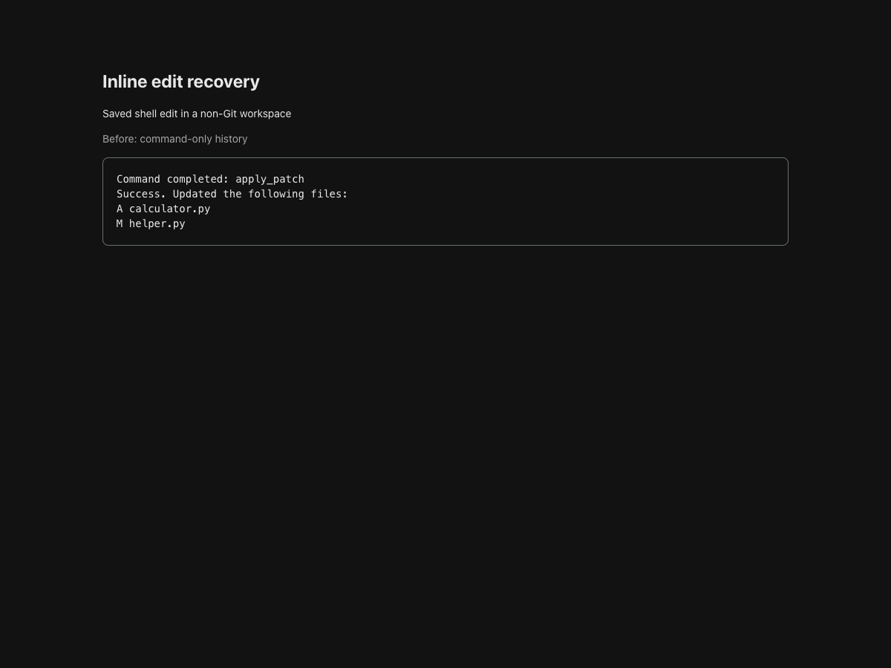
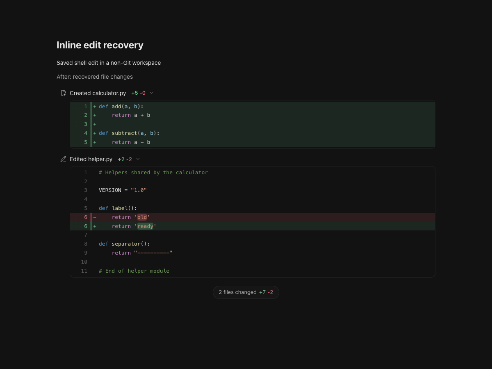
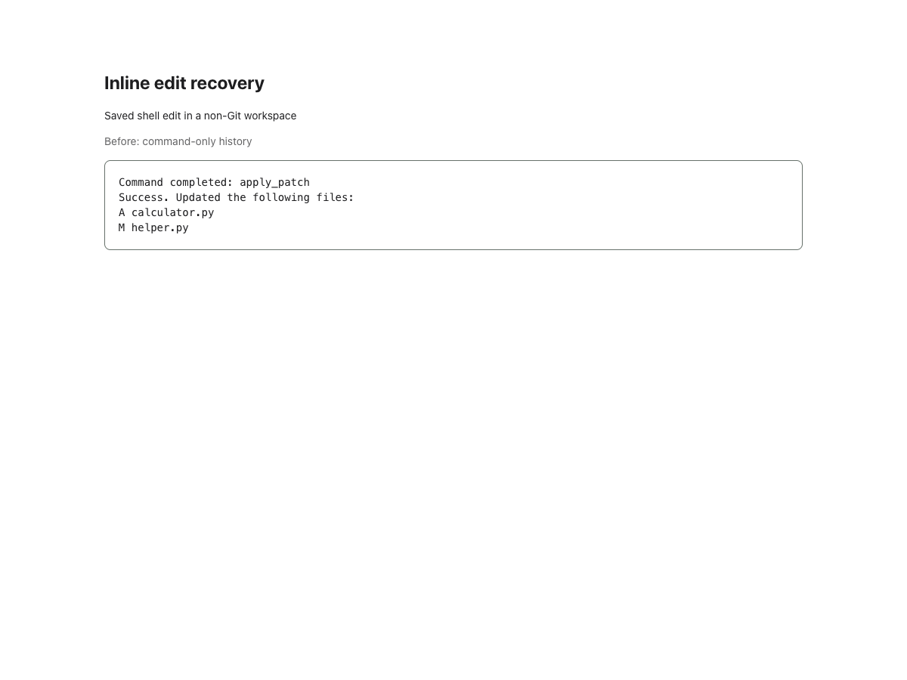
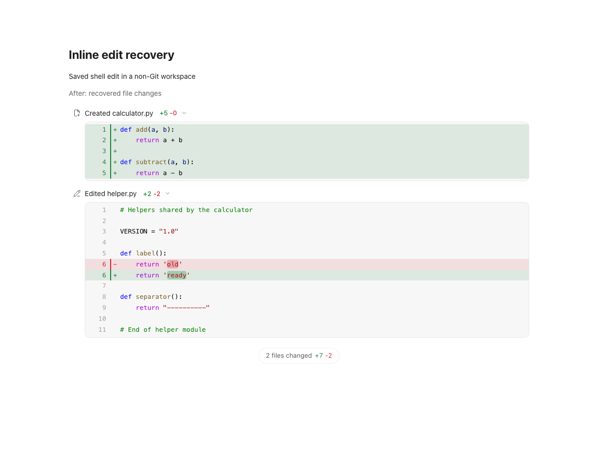

# Inline diff recovery: issue 781

## Scope

Recover historical successful shell patches at read time without rewriting the
database or revision cursors. Preserve command/start/output evidence across sparse
completion events. Extend the original whole-file editor to recorded scratch-chat
files, retaining hunk boundaries and grouping subsequent edits after a rename.

No production CSS, colours, layout, preferences or editor controls changed. The
original whole-file renderer is present in commit `ac7c650f`; this fix reconnects
missing source/evidence rather than replacing that renderer.

## Red and green

- Before implementation, the new saved/live recovery tests failed: three failures
  with the existing shell-patch test still passing.
- The new full-file service and contextual-hunk cases both failed before the
  full-file implementation (unsupported scoped read and incomplete model).
- The DOM workflow was bundled against actual source from main `48ce10bb`.
  It failed because the header, untouched middle and footer were absent.
- The same DOM workflow passes with this change in light and dark themes.
- 62 focused Node tests pass: history recovery, streaming, whole-file modelling,
  importer compatibility, router patch-tool setup, Git colours and diff models.
- A further large-context assertion exercises 130,000 context lines below the
  512 KB file limit without overflowing the argument stack.
- Native typecheck passes. Markdown acceptance validation: 430 cases OK.

Local raw receipts are kept in `~/.muster-work/review/781/`:
`red-recovery.txt`, `red-full-file.txt`, `red-dom-main.txt`, `green-final.txt`,
`green-large-context.txt`, `green-dom.txt` and `typecheck.txt`.

## Browser evidence

The screenshots use a synthetic chat and real production React components.
The full-file responses come from the real service reading temporary fixture
files through `files.chatEdit`. No personal chat screenshots are published.
The preview imports the same existing Git-colour stylesheet as the application.

Verified in an isolated browser: both files and their pill; complete unchanged
context; syntax colours; green added rows and red deleted rows with matching
gutters; Collapse all and Expand all. Existing full-file preference is unchanged.

| Theme | Before recovery | After recovery |
| --- | --- | --- |
| Dark |  |  |
| Light |  |  |

## Limits and release gates

Historical writes without patch evidence or a baseline cannot be reconstructed.
Missing, oversized or ambiguously matching source is explicitly identified as an
incomplete recorded patch, never fabricated as a whole file. No new Keep/Undo
actions are offered without an existing review baseline.

Independent review is pending. The local installed application was not replaced
or restarted. Only the explicitly requested old pinned chat was inspected to
confirm the original appearance. Release/build verification remains a CI gate.
