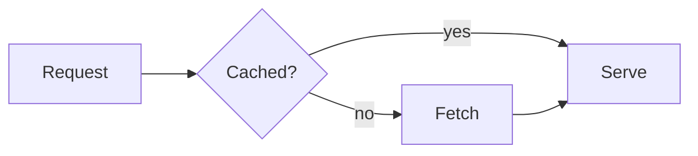

# Visualize

Muster draws visuals in the chat itself. Nothing needs installing, and nothing leaves the person's machine: pages run in
a sandbox with no access to Muster, the person's files or (unless they allow it) the network.

Pick the lightest form that does the job:

| Need | Use |
|---|---|
| A flow, sequence, state, class, ER, gantt, mind map or timeline diagram | a ```mermaid block in the reply |
| A bar, line, area, scatter, pie or donut chart of a few series | a ```chart block in the reply |
| A dashboard, report, mockup or interactive explainer | `render_html` (the `muster_browser` tools) |
| A picture of that page to keep with the reply | `render_html` with `image: true` |
| A running app or dev server | `preview_open` with its URL |

## Mermaid

Put only Mermaid source inside the fence and close it. Quote labels that contain punctuation (`A["Sign in (SSO)"]`).
No `%%{init}%%` blocks, no links, no HTML in labels: the app themes the diagram. If the diagram does not parse, the
person sees your source and the parse error, so fix the source and send it again.



## Charts

One JSON object: the short form below, or a Vega-Lite spec. Inline data only, no URLs and no colours.

```chart
{"type":"bar","title":"Sales by month","data":[{"month":"Jan","sales":12},{"month":"Feb","sales":18}],"x":"month","y":"sales"}
```

## Pages with render_html

Call `render_html` with `title` and `html` (one self-contained document, at most 512 KB, inline `<style>` and
`<script>`), before writing the reply; the page appears above it. Do not describe the page again in prose.

- Colours come from the person's theme as CSS variables on `:root`: `--background`, `--foreground`, `--muted`,
  `--muted-foreground`, `--card`, `--border`, `--accent`, `--success`, `--warning`, `--destructive`, and
  `--chart-1` to `--chart-6` for series. Use them so the page reads in light and dark; never hard-code a white page.
- Fluid width (about 720 px), no outer border or banner title, fixed pixel heights for charts, no `100vh`.
- No network by default: inline everything. Pass `network: true` only for a CDN library or remote images you truly
  need; the person is asked once on the card.
- Draw charts with inline SVG or a small inline script. Keep scripts to the page itself.

## A PNG to attach

Pass `image: true` to `render_html`. The page still shows inline, and Muster also saves a PNG of it with the chat and
answers with its path and the Markdown to attach it, for example ``. Put that
Markdown in the reply where the picture belongs. The picture uses the person's theme and is about 720 px wide.

## Check your work

Read what each tool answers. If a page or picture could not be made, the answer says why: fix the page and call it
again rather than describing what it would have shown.
